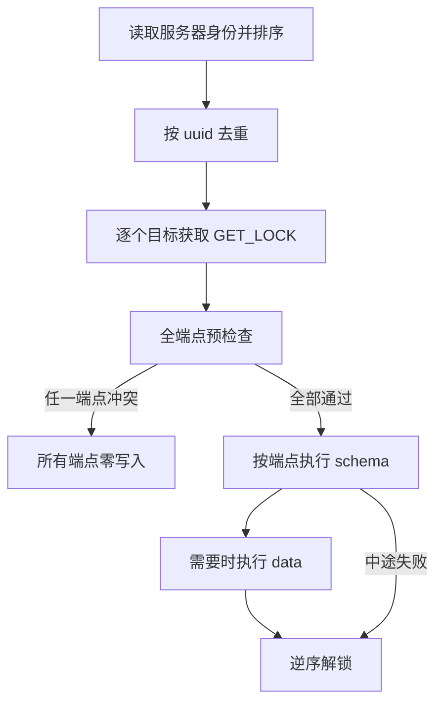

# 设计：Admin migrator 的 schema 与 data 维护

`dbha-admin migrate` 维护 Admin 受管库的表结构和默认切换策略。本文说明目录从哪里来、一次执行如何排序和加锁，以及 schema、data 各自在什么条件下创建、只记账、重跑或拒绝写入。

相关文档：[架构总览](./overview.md) · [采集与上报](../flows/probe-harvest-and-report.md) · [故障判定与切换](../flows/failure-detection-and-failover.md) · [文档索引](../README.md)

代码入口是 [`migrator.Run`](../../internal/admin/migrator/migrator.go)。判定函数分别是 [`schemaChoice`](../../internal/admin/migrator/decide.go) 和 [`planDefaultStrategies`](../../internal/admin/migrator/data.go)。

## 1. 边界

六张受管表的列、索引和主键以 [hamodel](../../pkg/storage/hamodel) 里的 GORM struct 为唯一定义。migrator 从标签生成 SQL 并执行，不调用 GORM `AutoMigrate`，也没有 down。

受管表按这个顺序进入目录：

1. `t_dbha_status`
2. `t_dbm_metadata`
3. `t_skip_dbinstance`
4. `t_db_switching_log`
5. `t_db_switching_snapshot_log`
6. `t_db_switching_strategy`

`t_db_black_white_list` 和心跳表不在目录内。账本表 `schema_migrations`、`data_migrations` 由 migrator 单独创建，也不从 GORM 模型生成。

## 2. 命令与组合

默认 `--type all`。`--inventory` 忽略 type，只做只读盘点。

| 调用 | schema 流程 | data 流程 | 库不存在 |
| --- | --- | --- | --- |
| `--type schema` | 执行 | 不执行 | 有全局 `CREATE` 时建库 |
| `--type data` | 不执行 | 执行 | 失败，不建库 |
| `--type all` | 先执行 | 后执行 | 有全局 `CREATE` 时建库 |
| `data` 加 `--repair-missing-schema` | 拒绝执行 | 拒绝执行 | 不连接后改库 |
| `schema` 加 `--repair-missing-data` | 拒绝执行 | 拒绝执行 | 不连接后改库 |
| `data` 加 `--repair-missing-data` | 不执行 | 执行，并允许补缺失默认身份 | 失败，不建库 |
| `data` 加 `--repair-missing` | 不执行 | 执行，并允许补缺失默认身份 | 失败，不建库 |
| `--inventory` 加任一 repair | 拒绝执行 | 拒绝执行 | 不改库 |
| `--inventory` | 不执行 | 不执行 | 只读；仍会加锁 |

修复开关有三个：

- `--repair-missing-schema` 修复数据以外的结构：重建已记账但缺失的表（空表，不恢复被删除的行），补回已记账但缺失的列和二级索引，并放行第 5.1 节的建表门槛。只在 `--type schema` 或 `--type all` 下生效，和 `--type data` 或 `--inventory` 组合时命令直接失败，不会先改结构。
- `--repair-missing-data` 只影响默认策略，不能和 `--type schema` 或 `--inventory` 组合。
- `--repair-missing` 同时打开上面两项，修复范围跟随 `--type`：`schema` 只修结构，`data` 只修数据，`all` 两者都修。它不能和 `--inventory` 组合。`--type data --repair-missing` 不修结构，策略表缺失时仍报 `strategy table is not ready`。

已记账的策略表被重建后是空表。data 版本 1 已在账本里时，只有打开数据修复（`--repair-missing` 或 `--repair-missing-data`）才会重新插入默认策略；只带 `--repair-missing-schema` 时策略表保持为空。只有 data 账本也不存在时，重建后的空表才会按初始化插入默认策略。

不修复、在预检查阶段报 conflict 的结构：列类型族不符、唯一与非唯一索引互相冲突、同名但形状不对的索引（前缀比模型短或列不同）、未知主键形状、账本名冲突或账本表结构异常。多余的列和索引保留，不删除。

兼容性变化：

- 删除 `--accept-missing-tables`，由 `--repair-missing-schema` 替代；删除 `--repair-missing-tables`，改名为 `--repair-missing-schema`。旧参数会报 unknown flag。
- 建表门槛报错的结果从 `accept` 改为 `need_repair`。
- `--repair-missing` 以前只补列和索引；现在也重建缺失的表、放行建表门槛，并在 data 阶段补缺失的默认策略。
- 同名但形状不对的索引在所有模式下都判为 conflict，inventory 中该端点归为 `conflict`。以前会在执行 `ADD INDEX` 时因 MySQL 1061 重名失败。

所有非 inventory 写入都拒绝 `read_only` 或 `super_read_only`。migrator 不预检账号权限，迁移账号需要 `SELECT`、`INSERT`、`UPDATE`、`CREATE`、`ALTER`、`INDEX`，库不存在时还要能建库。权限不足由执行到的语句直接返回 MySQL 错误（例如 1044、1142）。`information_schema` 只返回当前账号可见的对象，权限不足时库或表可能被当成不存在，报错会表现为 `strategy table is not ready` 或 `schema step blocked`，而不是权限错误；对已存在但不可见的表执行 `CREATE TABLE` 会被 MySQL 拒绝，不会产生破坏性写入。

Admin 进程只接受一个 `storage.endpoint`。`migrate` 和 receiver 的 sink 接受以分号分隔的多个端点。同一份配置不能同时把多个端点交给 Admin 常驻进程。

迁移连接只设置 10 秒连接超时，不设置读写超时。长 DDL 或回填不会被 30 秒读超时打断；语句卡住时由操作者停止进程。`GET_LOCK` 仍最多等待 30 秒。

schema 收敛可能锁住受管表，执行前要停止这些表的写入。每条 `ALTER` 都会把会话的 `lock_wait_timeout` 和 `innodb_lock_wait_timeout` 临时设为 5 秒，包括普通补列、建索引和收敛计划里的每一条 `ALTER`。语句结束后恢复会话原值；恢复失败时本次迁移失败、该步不记账，重跑时从未完成处继续。收敛里的回填 `UPDATE` 同样使用这个上限，并且每批最多 1000 行、各自提交，直到某一批不足 1000 行为止；中途失败时已提交的批次保留，日志记录 `filled_rows`，重跑从剩余行继续。建表语句不使用这个上限。5 秒限制的是等待元数据锁或行锁，锁拿到之后语句可以继续执行。迁移连接不设置读写超时。`idx_description` 在 `mediumtext` 上使用 255 字符前缀；utf8mb4 下该前缀是 1020 字节，老的 COMPACT 行格式或 `innodb_large_prefix=OFF` 可能超过 767 字节。

部署顺序是停写、`--inventory`、`migrate`、启动。Makefile 和 `scripts/` 不自动调用 migrate。

## 3. 一次执行

身份优先读 `@@server_uuid`。只有服务器不认识这个变量（错误码 1193，例如 MariaDB 或老版本）时才用 `@@server_id`，并记一条警告；其他读取错误直接失败。这种回退身份不参与跨端点去重或冲突判断；`server_id`、主机和端口都相同的回退连接只保留一条，复用时记警告。容器场景下不同实例常有相同的主机名和端口，靠 `server_id` 区分。端口使用服务器内部的 `@@port`，不是客户端看到的映射端口。真实 `server_uuid` 的排序键是 `server_uuid|hostname|port`。排序后每个 uuid 只保留一条连接；排序键完全相同时保持配置里的相对顺序。uuid 相同但主机或端口不同则冲突。其余别名连接只用于识别，随后关闭，不迁移。

锁名是 `dbha_migrate_` 加受管库名。每个目标使用自己的 `*sql.Conn`，在这条物理连接上等待最多 30 秒获取 `GET_LOCK`。全部目标先加锁，再做全端点预检查。任一端点冲突，所有端点都不写。权限不在预检查范围内，权限不足会在执行阶段报错，此时前面的端点可能已经写入；补齐权限后重跑即可。

通过后按端点串行执行。后面的端点失败不回滚前面的端点。同一个端点里已经成功的 DDL 和账本行也不会被后续失败回滚。

## 4. 目录生成

[`schema_reflect.go`](../../internal/admin/migrator/schema_reflect.go) 反射六张表的导出字段。建表、补列和索引 SQL 都从这些标签生成，不另存一份列定义。

- 只有精确的 `primaryKey` 是主键。`premaryKey` 不进入主键。`logcial_city_name` 保持历史拼写。
- 未写 `type` 时，字符串生成 `varchar(128)`，有符号整数生成 `bigint`，无符号整数生成 `bigint unsigned`，`time.Time` 生成 `datetime`，名为 `JSON` 的类型生成 `json`。指针先解引用。字符串别名和整数别名按底层类型处理。
- 建表时，`primaryKey` 或 `not null` 生成 `NOT NULL`，并保留自增和具体默认值。普通补列去掉自增。只有同时具备 `not null` 和具体默认值才保持 `NOT NULL`，否则补成 `NULL`。主键自增列补列时保留 `NOT NULL AUTO_INCREMENT`，并在同一条语句追加非唯一索引 `idx_migrate_<column>`。
- `default:null` 只表示可空，不输出 `DEFAULT NULL`。它与不写默认值生成相同的 SQL，但收敛时不保留线上时间默认值，见第 5.2 节。`autoCreateTime` 和 `autoUpdateTime` 不生成数据库时间默认值。
- 新库使用 `utf8mb4` / `utf8mb4_unicode_ci`。新表只追加 `ENGINE=InnoDB DEFAULT CHARSET=utf8mb4`。已有库和表不改字符集或排序规则。
- `MigrateKnownPKs` 只返回历史主键，不重复目标主键。状态表的历史主键是 `machine_id, bk_cloud_id, db_ip, db_port`，目标主键再加 `harvest_type`。策略表的历史主键是 `(id)` 和 `(bk_biz_id, trigger_event_name, trigger_event_name_reason)`，目标主键是 `(id, bk_biz_id, trigger_event_name, trigger_event_name_reason)`。
- 没有历史主键的表不生成主键步骤。这些表的线上主键不是模型主键时，建表步骤直接冲突。

`migrate:"historical:<type>"` 只声明线上旧类型可以收敛到当前模型，不改写已发布的 `ADD COLUMN` 或 `CREATE TABLE`。带这个标签的列在启动校验时使用冻结 SQL 中的列文本：`ADD COLUMN` 步骤直接比对冻结的 ADD，`CREATE TABLE` 步骤取冻结 CREATE 中同名列的定义。两者可以不同，例如非空主键列在 ADD 中是可空形态。因此以后放宽 Target 不会把普通步骤判为变更。冻结 CREATE 中找不到该列时启动校验失败。未发布的新表没有冻结 CREATE，建表 SQL 按当前 Target 生成。当前带这个标签的列是快照表的 `result`。`migrate:"emptyAsDefault"` 只声明主键替换时可以把空字符串填成模型默认值。当前带这个标签的列是状态表的 `harvest_type`。

## 5. schema 维护规则

结构变更只来自 `--type schema` 和 `--type all`。`--repair-missing-schema` 与 `--repair-missing` 只在这两种类型下改变 schema 判定。只跑 schema 时不插入策略数据。

已发布步骤先执行全部建表、补列和建索引，再执行列定义和主键收敛。模型里新出现的普通步骤插在这两段之间，因此新索引会在相关主键收敛之前创建。步骤名是 `%06d_<name>`。已发布版本连续编号；新增步骤使用更大的版本，执行顺序不按版本号重排。细节见第 7 节。

### 5.1 建表、补列和索引

[`schemaChoice`](../../internal/admin/migrator/decide.go) 对普通对象使用下面的判定。预检查阶段出现 conflict、drift 或 need_repair，所有端点零写入。下表中的「结构修复」指 `--repair-missing-schema` 或 `--repair-missing`。

| 现场 | 判定 |
| --- | --- |
| 类型、主键或账本名冲突 | conflict |
| 同名索引已存在，但前缀比模型短或列不同 | conflict，不受修复开关影响 |
| 对象已存在且形状可接受 | record |
| 未记账且对象不存在 | apply，不需要 repair 开关 |
| 已记账但表缺失 | 只有结构修复才重建为空表，不恢复被删除的行；否则 drift |
| 已记账但列或索引缺失 | 只有结构修复才补回；否则 drift |
| 部分受管表缺失，且该建表步骤未记账 | 没有结构修复时停在建表门槛，结果是 need_repair |

用户多出的列和索引保留。除了第 5.4 节允许删除的 `idx_migrate_<column>`，不删除列或索引，不改字符集，不缩窄类型。

旧补列步骤使用宽松类型族：

| 模型类型族 | 旧补列步骤接受 |
| --- | --- |
| 整数 | 各整数类型互通，不比较 `unsigned` |
| `varchar` | `varchar`、`char` 和 text 族 |
| `json` | `json` 或 text 族 |
| `datetime` | `datetime` 或 `timestamp` |
| text | 只接受 text 族 |

声明了历史类型时，有长度的类型同时比较数据类型和长度，没有长度参数的类型只比较数据类型。因此 `result` 的旧 `varchar(128)` 不会挡住后面的扩容步骤。旧步骤兼容不等于列定义已经满足模型。

索引按列顺序、唯一性和前缀判断，不按索引名判断：

- 更长且唯一性相同的索引可以满足前导列相同的要求。
- 更长但唯一性不同的索引既不算满足，也不算冲突，迁移会再尝试创建目标索引。
- 全列索引可以满足前缀要求。较短前缀不能满足较长前缀或全列要求。
- 完全相同的列上唯一性不同是冲突。
- 同名但列不同的索引不会被改写。创建同名目标索引时，由数据库拒绝该步。已有索引不会被修改。

### 5.2 列定义

每个受管列都有一个列定义步骤。它比较数据类型、声明中的长度、`unsigned`、空值、默认值和自增。预检查看到缺列时不因此冲突，缺列由前面的补列步骤处理；但表已有数据、目标为 NOT NULL 且无默认值、又不是自增列时，补出的列只能是 NULL，预检查阻断（`schema step blocked`，`result: not_null`），与第 7 节一致。真正执行时列仍缺失，该步失败且不记账。

| 线上列 | 动作 |
| --- | --- |
| 已满足模型 | 只记账 |
| 可识别的安全差异 | 执行 `MODIFY`，复查通过后记账；已记账的历史形态也会重跑 |
| 未知或危险差异 | conflict，预检查阶段所有端点零写入 |

满足模型使用这些容量规则：

- 同一种 `varchar` 或 `char` 中，更大的长度满足更短的长度。
- `longtext` 满足 `mediumtext`，`mediumtext` 满足 `text`。
- 线上整数宽度更大、符号性相同，且模型也是整数时，视为满足，不把列缩窄。
- `datetime` 与 `timestamp` 只因类型不同不算冲突。模型没有默认值或自动更新时间时，线上的 `NOT NULL DEFAULT CURRENT_TIMESTAMP`、`CURRENT_TIMESTAMP(n)` 和 `ON UPDATE CURRENT_TIMESTAMP[(n)]` 视为满足，只告警并保留，不把 `timestamp` 改成 `datetime`。确需其他收敛时，`MODIFY` 仍保留这些时间属性。
- 模型显式写了 `default:null` 时，可空时间列上的 `CURRENT_TIMESTAMP[(n)]` 默认值和 `ON UPDATE CURRENT_TIMESTAMP[(n)]` 不保留，作为安全差异执行 `MODIFY` 去掉它们，目前只有策略表 `deleted_at`。线上为 `NOT NULL` 时按“改为可空”判冲突。已经被默认值写成当前时间的存量行不改写，需人工核对是否被误判为软删除。
- 把 `timestamp` 当作满足 `datetime` 时，列仍受 `timestamp` 的 2038 年上限和会话时区转换约束。`explicit_defaults_for_timestamp=OFF` 时，后续 `timestamp` 列被自动加上的 `DEFAULT '0000-00-00 00:00:00'` 仍判冲突。
- 可空列上 MariaDB 返回的文本 `NULL` 按 SQL NULL 处理。MariaDB 10.2.7 起 `COLUMN_DEFAULT` 给字符串字面量加单引号；服务器版本含 `MariaDB` 时，完整的单引号字面量去掉外层引号并把 `''` 还原为 `'` 后再比较，`'NULL'` 仍是非空字面量。MySQL 返回的值不做处理。
- `varchar`、整数、时间、`json` 和 text 之间不按容量互相满足。`text` 不满足 `varchar`。线上整数更窄仍然是冲突。

只有下面的差异会生成 `MODIFY`：

- 声明过的历史类型扩到模型类型。
- 原来没有非空字面量默认值时，补上模型默认值。
- 改为 `NOT NULL`。
- 增加 `AUTO_INCREMENT`。
- 列中没有负数时补上 `unsigned`。
- 模型显式 `default:null` 时，去掉可空时间列上的 `CURRENT_TIMESTAMP` 默认值和 `ON UPDATE`。

除历史类型扩容外，这些修改保留线上更大的类型和长度。可空列的 SQL `NULL` 默认值，以及 MariaDB 在可空列 `COLUMN_DEFAULT` 中返回的文本 `NULL`，同时满足 `default:null` 和不写默认值。非空列上的字符串字面量 `NULL` 仍是非空默认值。

下列差异是冲突：已有非空默认值与模型不同、含负数却要改成无符号、缩窄类型、缩短长度、去掉非时间默认值、改为可空、去掉自增、去掉 `unsigned`。时间列上保留下来的 `CURRENT_TIMESTAMP` 不属于这里的非空默认值冲突。`MODIFY` 的列定义顺序是类型、字符集、排序规则、空值、默认值、`ON UPDATE`、自增、注释，并带上该列当前的字符集、排序规则、注释和时间属性；显式 `default:null` 的列不带时间默认值和 `ON UPDATE`。新建表 SQL 不从旧列复制这些属性。

改为 `NOT NULL` 之前，模型有具体默认值且列中存在 NULL 时，先单独 `UPDATE` 再 `MODIFY`。自增列里的 NULL 先写成互不重复的新值：全部为 NULL 时从 1 开始，已有非空值时从当前最大值的下一个整数开始，已有非空值保持不变。`UPDATE` 与后面的 DDL 不能放在同一事务。回填已经提交而 `MODIFY` 失败时，不记录该列步骤，重跑从剩余 NULL 继续。没有具体默认值、又不是自增列、列里仍有 NULL 时，不执行 `MODIFY`，预检查阻断（`result: not_null`）。

### 5.3 主键

主键步骤只生成在声明了历史主键的表上，目前是状态表和策略表。缺表时不绕过第 5.1 节的建表门槛。

| 现场 | 动作 |
| --- | --- |
| 已是模型主键 | 只处理可以安全删除的临时索引，然后记账 |
| 主键属于历史主键，且没有外键引用 | 执行主键替换；空字符串按第 5.4 节处理 |
| 未知主键、被外键引用，或无默认值且非自增的主键列含 NULL | 预检查失败，所有端点零写入 |

空字符串只在主键仍是历史主键并准备替换时处理，而且列必须带 `emptyAsDefault`。主键已经是目标形态时不再改空字符串。NULL 回填属于列定义步骤，主键步骤不重复填充 NULL。

### 5.4 自增临时索引

自增列还不是任何索引的最左列时，补列或补 `AUTO_INCREMENT` 的同一条 `ALTER` 创建普通索引 `idx_migrate_<column>`。同名但列或顺序不符是冲突。

新主键以该自增列为最左列，并且这个临时索引结构匹配时，才在同一条主键 `ALTER` 里删除它。它是自增列唯一的最左索引时保留。不删除用户自己的索引。

### 5.5 账本与失败

schema 执行前先确保数据库和 `schema_migrations` 存在。新执行的 DDL 只有复查通过才记账。对象已经满足目标时直接记账。已有同版本、同名行不更新。同版本、不同名是冲突。

`schema_migrations` 或 `data_migrations` 已经存在，但主键、列或 `name` 唯一索引的形状不符时，预检查直接冲突，不重建账本。

两张账本表由 [`ledger.go`](../../internal/admin/migrator/ledger.go) 里的内部模型定义，形状检查、读取和写入都从模型取列。账本不是受管表，不生成 schema 步骤。建账本表的 `CREATE` 语句是冻结文本，契约测试保证它与模型一致。

DDL、复查或记账失败都返回失败。DDL 已经提交时无法回滚，重跑依靠幂等检查继续收敛。失败步骤不记账，同一端点此前成功的步骤保持记账。已经满足的步骤只记账，不逐条打印检查日志。成功变更和端点汇总结论见第 6.4 节。

## 6. data 维护规则

`--type data` 不建业务表，不跑 schema 收敛，也不把主键纳入就绪条件。库不存在时直接失败。`all` 先完成 schema，再跑 data。与 repair 开关的组合遵循第 2 节。

### 6.1 就绪

[`strategyReady`](../../internal/admin/migrator/data.go) 要求策略表已经具备 hamodel 模型声明的全部列（自增主键除外）。历史策略表没有 `id`，所以不检查自增列。列清单不另外手写，hamodel 增加列后，`--type data` 也会要求该列存在，存量库要先跑 schema。

列类型按第 5.1 节的旧补列类型族判断，不要求列定义步骤已经完成，也不要求主键已经是目标形态。模型声明的全部唯一索引必须存在；比较列、唯一性和前缀，不比较索引名。缺任一列或唯一索引时预检查失败，并且发生在创建 data 账本之前。

### 6.2 默认策略

[`planDefaultStrategies`](../../internal/admin/migrator/data.go) 只维护五条 `bk_biz_id=0` 的默认策略。身份只看 `bk_biz_id` 与 `trigger_event_name`，同一身份只读取一行。同一身份有多行（`trigger_event_name_reason` 不同）时，按原因相同、原因不同、原因为 NULL 的顺序取行，其次取未软删除的行；排名相同的行得出的动作相同。身份匹配在数据库里完成，大小写等比较由列的排序规则决定。默认策略的读写通过 GORM 使用 hamodel 模型，不手写列名；`created_at`、`updated_at` 和账本的 `applied_at` 取数据库的 `NOW()`。迁移连接按 UTC 解析与写回时间，字面值不随迁移机时区变化。

| 事件名 | 事件原因 |
| --- | --- |
| `dbha_doublecheck_ssh_fail` | `ConnectionException` |
| `dbha_ssh_auth_failure` | `SSHAuthException` |
| `dbha_ssh_timeout` | `SshTimeout` |
| `dbha_disk_write_failure` | `DiskWriteException` |
| `dbha_uptime_failure` | `UptimeException` |

共同字段是 `status=enabled`、`trigger_count=1`、`priority=9999`、`scope=host`、`action=switch`、空 description。`name` 等于事件名。

| 现场 | 动作 |
| --- | --- |
| 表为空，且 data 版本 1 不存在 | 插入五条默认策略 |
| 表为空，data 版本 1 的 name 匹配，且未开数据修复 | 成功返回，不插入，也不重写账本 |
| 表为空，data 版本 1 的 name 不匹配 | 账本冲突，不插入 |
| 表为空，且开了数据修复（`--repair-missing-data` 或 `--repair-missing`） | 重新插入五条默认策略 |
| 已有任意行，五条身份都存在 | 不更新已有行；软删除也算存在 |
| 已有任意行，缺少身份，且开了数据修复 | 只插入缺失身份，不更新已有行 |
| 已有任意行，缺少身份，且未带修复开关 | 命令成功返回，不插入，也不写 data 账本 |

软删除是 `status='deleted'` 或 `deleted_at IS NOT NULL`。命中软删除时记 `action: keep-deleted`，不恢复该行。日志字段见第 6.4 节。

### 6.3 data 账本

五条默认身份都存在，或本次计划会把它们补齐时，才创建 `data_migrations` 并写版本 1 的账本行 `000001_default_global_strategies`。仍有缺失且未开修复开关时，不建 data 账本，也不写账本行。

建账本表是 DDL，位于数据事务之外。默认策略 `INSERT` 与账本行在同一事务里，失败则整笔回滚。账本行已存在且名字一致时不更新。同版本、不同名时报错并回滚。

`required_schema_version` 记录策略表建表步骤的版本，不是最新的 schema 版本。当前 data 只有这一个固定步骤，没有通用的 data step 目录。

### 6.4 执行日志

已经满足并只需记账的 schema 步骤不打印 `phase: check`。错误、预检查、inventory、别名连接和解锁失败日志保持原样。日志不包含 SQL，也不包含策略行内容。

schema 步骤在 DDL、复查和记账都成功，并且确实执行了变更后，打印：

`schema changed, endpoint, action, version, name, object, target`

- `action: create`：未记账对象的首次创建，包括首次安装和结构修复放行建表门槛后补建的表。
- `action: repair`：已记账对象缺失后，由 `--repair-missing-schema` 或 `--repair-missing` 重建空表、补回列或索引。
- `action: converge`：列定义或主键向模型收敛。

`object` 是 `table`、`column`、`index`、`column_definition` 或 `primary_key`。`target` 分别是表名、`table.column`、`table.index`、`table.column` 和 `table.primary_key`。

列定义或主键最终没有语句时，不打印 `schema changed`。复查通过后计入 `schema_unchanged` 并记账。复查失败返回错误，不计入结论。`UPDATE` 已经提交但后面的 `MODIFY` 失败时，不打印成功日志，并返回原来的错误。

data 只在 `ApplyStrategies` 成功返回后逐条打印。日志字段是 `endpoint`、`bk_biz_id`、`trigger_event_name` 和 `action`：

- 空表且没有 data 版本 1 时，首次插入是 `action: initialize`。
- 空表且 data 版本 1 已匹配时，默认身份是 `action: skip`，不重写账本。
- `--repair-missing-data` 补入缺失身份，或在账本已存在时重新插入空表，是 `action: repair`。
- 表里已有数据但缺少身份、且未开修复开关时，缺失身份是 `action: skip`。
- 软删除行是 `action: keep-deleted`。

`initialize` 和 `repair` 只在事务提交成功后进入结果。事务失败或 data 账本创建失败时，不打印这些成功日志。已经存在且未软删除的默认身份不逐条打印。自定义行不打印，也不进入计数。

每个端点在 schema 和 data 都处理完后打印一行：

`migrate finished, endpoint, schema_unchanged, schema_created, schema_repaired, schema_converged, data_unchanged, data_initialized, data_repaired, data_skipped, data_kept_deleted`

没有执行的部分计数为 0。data 没有运行时，五个 data 计数都是 0。data 运行且五条默认身份都已存在、且未软删除时，`data_unchanged` 为 5。`data_unchanged` 只统计这五条默认身份，不按策略表总行数计算。中途失败不打印这行；已经成功的对象日志保留。

## 7. 后续改动的限制

表顺序、字段声明顺序和索引首次出现顺序共同决定 schema step 的 version、name 和 SQL。已发布后它们属于迁移 ABI：

- 不重排字段、表或索引。
- 不把目标主键重复写进 `MigrateKnownPKs`。
- 不复用或改名已发布步骤。
- 修改 GORM tag 后运行模型契约、已发布步骤稳定性和收敛回归。

当前已发布步骤保存在 [`published_steps.go`](../../internal/admin/migrator/published_steps.go)。运行时原样使用其中的 version、name 和 Apply。模型里新出现的列、索引和对应收敛步骤从最大 version 之后追加，不改写已发布 `CREATE TABLE`。带 `historical` 的已发布列以冻结 SQL 为基准校验，Target 变宽后由列定义步骤收敛，不重写旧的 `ADD` 或 `CREATE`。执行顺序是已发布普通步骤、新增普通步骤、已发布收敛步骤、新增收敛步骤。已发布步骤缺失，或没有 `historical` 标签的已发布 Apply 与模型生成结果不同，启动和测试直接失败。

追加步骤的 version 按"表顺序、普通步骤、收敛步骤"在运行时依次分配，没有冻结就会被后续模型改动挤到别的 version，存量库账本随之冲突。因此每次模型变更都要在同一个改动里把追加步骤冻结进 `published_steps.go`。`TestNoUnpublishedSchemaSteps` 在存在未冻结步骤时失败，并打印可直接粘贴的步骤字面量。

策略表在主键收敛前追加唯一索引 `idx_biz_event_reason(bk_biz_id, trigger_event_name, trigger_event_name_reason)`，用来保留旧三元组唯一性。软删除只改状态或删除时间，行仍占用这三列，因此不能按同一业务、事件和原因再插入一行。admin 的创建、批量创建、更新和批量更新遇到该唯一键冲突时返回 400，说明同一业务、事件和原因已存在（可能已软删除），不返回原始数据库错误；名称唯一键 `idx_name` 的并发冲突同样返回“名称已存在”。即将创建的唯一索引会先做重复行探测；可空列上的多个 `NULL` 按 MySQL 规则不算重复，非空且完全相同的行才会阻断。`NOT NULL`、无默认值、非自增的列在表已有数据时也会在预检查被阻断。`--type data` 要求模型里的唯一索引已经存在，所以存量库要先完成 schema。

普通已记账步骤不会因为 Apply 文本变化而重放。列定义和主键只收敛代码明确识别的安全历史形态。改旧字段标签、旧索引标签或旧建表 SQL，不能假定存量库会自动重放。

data 版本 1 的五条默认身份和业务字段是已发布契约。新增独立 data 任务时，不覆盖版本 1，也不只改名字。需要先扩展成按版本顺序执行的 data step，并定义新的 version、name、`required_schema_version`、事务和幂等检查。

改动后的最低验证：

- model/catalog contract
- published-step stability
- schema convergence
- data repair
- `CGO_ENABLED=0 go vet ./pkg/storage/hamodel/ ./internal/admin/migrator/`
- `CGO_ENABLED=0 go test ./pkg/storage/hamodel/ ./internal/admin/migrator/ -count=1 -timeout 120s`
- 在 `127.0.0.1:13306` 和 `127.0.0.1:13307` 上运行 `CGO_ENABLED=0 go test -tags integration ./internal/admin/migrator/ -count=1 -timeout 300s -run 'TestMySQL'`

## 8. inventory

`--inventory` 完成第 3 节的身份排序、去重和加锁，然后只读盘点。它不创建数据库、业务表或账本，也不执行修复。

端点分类：

| 分类 | 含义 |
| --- | --- |
| `empty` | 六张受管表都不存在 |
| `partial` | 只存在一部分受管表 |
| `complete` | 六张受管表都存在 |
| `conflict` | 任一 schema 步骤冲突，或任一账本形状、账本名冲突 |

每张表还有独立的 `key_status`，它只描述当前主键，和端点分类里的 `conflict` 不是一回事：

| key_status | 含义 |
| --- | --- |
| `model` | 当前主键等于模型主键 |
| `historical` | 当前主键属于该表声明的历史主键 |
| `unrecognized` | 既不是模型主键，也不是已知历史主键 |
| `-` | 表不存在 |

未知列定义、索引冲突和账本冲突不写入 `key_status`。它们让端点整体分类变成 `conflict`。

`LoadInventory` 对已经存在的受管表执行 `COUNT(*)`，不读取策略行。这个查询只服务 inventory。报告写入 stdout，在全部已读端点处理完后一次写出。配置、锁、历史主键警告和失败错误仍走 stderr 上的日志。stdout 不打印策略行，也不打印连接密码。

报告第一行是端点数量、四种 `class` 的数量，以及已读完端点是否存在缺表、缺列或冲突。都没有时写 `changes: none`。每个端点先写 `endpoint`，下一行同时写 `class`、`version`、`create_tables`、`add_columns`，字段之间四个空格。冲突行在这一行后面、六行摘要表前面。然后是六张表的左对齐摘要和唯一索引。摘要列是 `table`、`rows`、`key_status`、`primary_key`。标题和值左对齐，`primary_key` 不参与列宽，摘要行不折行。主键列之间用逗号加空格。表不存在时 `rows` 为 0，`key_status` 和 `primary_key` 为 `-`。

`create_tables` 和 `add_columns` 为空时写 `-`，非空时名字按发现顺序用逗号加空格接在同一行，不换行。缺列只统计已经存在的受管表，格式是 `表名.列名`。`class: conflict` 时缺表和缺列仍然显示。冲突行来自账本形状和现有步骤检查，不打印步骤 SQL。账本写 `conflict  ledger: schema` 或 `conflict  ledger: data`。步骤写 `conflict  table, kind, object`。`kind` 为 `table`、`column`、`index`、`column_def`、`primary_key`。没有冲突对象时不输出冲突标题。没有唯一索引时不输出唯一索引段。唯一索引行是 `unique`、表名、`索引名(列名)`，非唯一索引不打印。

默认报告没有列详情。`--inventory-full` 才为六张受管表中已经存在、并且至少有一列的表逐块打印。块的顺序与摘要表相同。块标题是行首的 `table:` 加表名，前面恰好一个空行。块内先写 `column` 和 `type`，再按列名字母顺序列出现有列，包括库里多出来的列，不补还不存在的列。列名先左对齐，宽度至少能放下 `column`，然后再空两格写类型，行尾不补空格。`varchar`、`char` 在长度大于 0 时写成 `varchar(128)`；整数在 `Unsigned` 时追加 ` unsigned`。不输出账本表。`--inventory-full` 可以单独使用，效果同样是只读盘点，并带上列详情。

最后一行是 `result: ok`、`result: conflict` 或 `result: failed`，与进程退出状态一致。读取中途失败时，`result: failed` 带上端点和已有 `errmsg`，总览只统计已经读完的端点。历史主键另外打一条警告：`known legacy primary key, endpoint, table, primary_key`。migrate 和 inventory 都打。

普通迁移的 `Load` 不做 `COUNT(*)`，也不读取策略行。预检查和收敛只对需要判断的列执行 `SELECT 1 ... LIMIT 1`，用来发现 NULL、负数和空字符串。任一端点存在结构或账本冲突时，inventory 仍读完所有端点，最后返回失败。

## 9. 源码地图

| 职责 | 路径 |
| --- | --- |
| 命令入口 | [`migrator.go`](../../internal/admin/migrator/migrator.go) |
| 六张表的步骤编号 | [`catalog.go`](../../internal/admin/migrator/catalog.go) |
| 从 GORM 标签生成目录 | [`schema_reflect.go`](../../internal/admin/migrator/schema_reflect.go) |
| schema 判定 | [`decide.go`](../../internal/admin/migrator/decide.go) |
| 锁和预检查 | [`precheck.go`](../../internal/admin/migrator/precheck.go) |
| Check、Apply、Verify、Record | [`apply.go`](../../internal/admin/migrator/apply.go) |
| 列定义和主键计划 | [`converge_plan.go`](../../internal/admin/migrator/converge_plan.go) |
| 收敛执行和 5 秒锁等待 | [`mysql_converge.go`](../../internal/admin/migrator/mysql_converge.go) |
| 数据库、账本和 schema 记账 | [`mysql_exec.go`](../../internal/admin/migrator/mysql_exec.go) |
| 默认策略和 data 账本 | [`data.go`](../../internal/admin/migrator/data.go) |
| 账本模型 | [`ledger.go`](../../internal/admin/migrator/ledger.go) |
