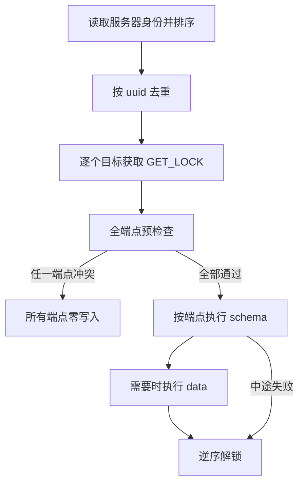

# 设计：Admin migrator 的 schema 与 data 维护

`dbha-admin migrate` 维护 Admin 受管库的表结构和默认切换策略。本文说明目录从哪里来、一次执行如何排序和加锁，以及 schema、data 各自在什么条件下创建、只记账、重跑或拒绝写入。

相关文档：[架构总览](./overview.md) · [采集与上报](../flows/probe-harvest-and-report.md) · [故障判定与切换](../flows/failure-detection-and-failover.md) · [文档索引](../README.md)

代码入口是 [`migrator.Run`](../../internal/admin/migrator/migrator.go)。判定函数分别是 [`schemaChoice`](../../internal/admin/migrator/decide.go) 和 [`planDefaultStrategies`](../../internal/admin/migrator/data.go)。

## 1. 边界

六张受管表的列、索引和主键以 [hamodel](../../pkg/storage/hamodel) 里的 GORM struct 为唯一定义。migrator 从标签生成 SQL 并执行，不调用 GORM `AutoMigrate`，也没有 down。

受管表按这个顺序进入目录：

1. `t_dbha_status`
2. `t_dbm_metadata`
3. `t_skip_dbinstance`
4. `t_db_switching_log`
5. `t_db_switching_snapshot_log`
6. `t_db_switching_strategy`

`t_db_black_white_list` 和心跳表不在目录内。账本表 `schema_migrations`、`dbha_data_migrations` 由 migrator 单独创建，也不从 GORM 模型生成。

## 2. 命令与组合

默认 `--type all`。`--inventory` 忽略 type，只做只读盘点。

| 调用 | schema 流程 | data 流程 | 库不存在 |
| --- | --- | --- | --- |
| `--type schema` | 执行 | 不执行 | 有全局 `CREATE` 时建库 |
| `--type data` | 不执行 | 执行 | 失败，不建库 |
| `--type all` | 先执行 | 后执行 | 有全局 `CREATE` 时建库 |
| `data` 加 `--repair-missing` | 先执行 | 执行，且策略表必须已就绪 | 失败，不建库 |
| `data` 加 `--repair-missing-tables` | 先执行 | 执行；预检查不要求策略表已经存在 | 失败，不建库 |
| `data` 加 `--repair-missing-data` | 不执行 | 执行，并允许补缺失默认身份 | 失败，不建库 |
| `--inventory` | 不执行 | 不执行 | 只读；仍会加锁 |

`--repair-missing` 和 `--repair-missing-tables` 会单独打开 schema 流程，所以它们和 `--type data` 一起使用时会先改结构。`--repair-missing-data` 只影响默认策略，不打开 schema 流程。

`--repair-missing-tables` 把缺失的受管表重建为空表。策略表因此被重建后，data 再按空表规则插入默认策略。只带 `--repair-missing` 时，data 预检查仍然要求策略表结构就绪。

所有非 inventory 写入都拒绝 `read_only` 或 `super_read_only`。写权限必须同时具备 `SELECT`、`INSERT`、`UPDATE`、`CREATE`、`ALTER`、`INDEX`，这些权限可以来自全局授权或受管库授权。表级授权不计入。库不存在时，schema 和 all 还要求全局 `CREATE`。

schema 收敛可能锁住受管表，执行前要停止这些表的写入。5 秒的 `lock_wait_timeout` 和 `innodb_lock_wait_timeout` 只作用于一条收敛计划的最后一条语句，而且该语句必须是 `ALTER`。回填 `UPDATE`、普通建表、补列和建索引不使用这个 5 秒上限。

## 3. 一次执行

身份优先读 `@@server_uuid`，读不到时用 `@@server_id`。端口使用服务器内部的 `@@port`，不是客户端看到的映射端口。排序键是 `server_uuid|hostname|port`。排序后每个 uuid 只保留一条连接；排序键完全相同时保持配置里的相对顺序。uuid 相同但主机或端口不同则冲突。其余别名连接只用于识别，随后关闭，不迁移。

锁名是 `dbha_migrate_` 加受管库名。每个目标使用自己的 `*sql.Conn`，在这条物理连接上等待最多 30 秒获取 `GET_LOCK`。全部目标先加锁，再做全端点预检查。任一端点冲突，所有端点都不写。

通过后按端点串行执行。后面的端点失败不回滚前面的端点。同一个端点里已经成功的 DDL 和账本行也不会被后续失败回滚。

## 4. 目录生成

[`schema_reflect.go`](../../internal/admin/migrator/schema_reflect.go) 反射六张表的导出字段。建表、补列和索引 SQL 都从这些标签生成，不另存一份列定义。

- 只有精确的 `primaryKey` 是主键。`premaryKey` 不进入主键。`logcial_city_name` 保持历史拼写。
- 未写 `type` 时，字符串生成 `varchar(128)`，有符号整数生成 `bigint`，无符号整数生成 `bigint unsigned`，`time.Time` 生成 `datetime`，名为 `JSON` 的类型生成 `json`。指针先解引用。字符串别名和整数别名按底层类型处理。
- 建表时，`primaryKey` 或 `not null` 生成 `NOT NULL`，并保留自增和具体默认值。普通补列去掉自增。只有同时具备 `not null` 和具体默认值才保持 `NOT NULL`，否则补成 `NULL`。主键自增列补列时保留 `NOT NULL AUTO_INCREMENT`，并在同一条语句追加非唯一索引 `idx_migrate_<column>`。
- `default:null` 只表示可空，不输出 `DEFAULT NULL`。`autoCreateTime` 和 `autoUpdateTime` 不生成数据库时间默认值。
- 新库使用 `utf8mb4` / `utf8mb4_unicode_ci`。新表只追加 `ENGINE=InnoDB DEFAULT CHARSET=utf8mb4`。已有库和表不改字符集或排序规则。
- `MigrateKnownPKs` 只返回历史主键，不重复目标主键。状态表的历史主键是 `machine_id, bk_cloud_id, db_ip, db_port`，目标主键再加 `harvest_type`。策略表的历史主键是 `(id)` 和 `(bk_biz_id, trigger_event_name, trigger_event_name_reason)`，目标主键是 `(id, bk_biz_id, trigger_event_name, trigger_event_name_reason)`。
- 没有历史主键的表不生成主键步骤。这些表的线上主键不是模型主键时，建表步骤直接冲突。

`migrate:"historical:<type>"` 只声明旧补列步骤可以接受的历史类型，不写入目标 SQL。`migrate:"emptyAsDefault"` 只声明主键替换时可以把空字符串填成模型默认值。当前带这个标签的列是状态表的 `harvest_type`。

## 5. schema 维护规则

结构变更来自 `--type schema`、`--type all`，以及第 2 节里会打开 schema 流程的 repair 组合。只跑 schema 时不插入策略数据。

每张表依次执行自己的建表、全部补列和全部建索引。六张表都完成后，再按表为每个受管列执行列定义步骤。有历史主键的表在自己的列定义步骤之后执行一个主键步骤。步骤名是 `%06d_<name>`，版本从 1 连续编号。

### 5.1 建表、补列和索引

[`schemaChoice`](../../internal/admin/migrator/decide.go) 对普通对象使用下面的判定。预检查阶段出现 conflict、drift 或 accept，所有端点零写入。

| 现场 | 判定 |
| --- | --- |
| 类型、主键或账本名冲突 | conflict |
| 对象已存在且形状可接受 | record |
| 未记账且对象不存在 | apply，不需要 repair 开关 |
| 已记账但表缺失 | 只有 `--repair-missing-tables` 才重建为空表，不恢复被删除的行；否则 drift |
| 已记账但列或索引缺失 | 只有 `--repair-missing`，或该表正在按缺失表重建，才补回；否则 drift |
| 部分受管表缺失，且该建表步骤未记账 | 没有 `--accept-missing-tables` 或 `--repair-missing-tables` 时停在建表门槛 |

用户多出的列和索引保留。除了第 5.4 节允许删除的 `idx_migrate_<column>`，不删除列或索引，不改字符集，不缩窄类型。

旧补列步骤使用宽松类型族：

| 模型类型族 | 旧补列步骤接受 |
| --- | --- |
| 整数 | 各整数类型互通，不比较 `unsigned` |
| `varchar` | `varchar`、`char` 和 text 族 |
| `json` | `json` 或 text 族 |
| `datetime` | `datetime` 或 `timestamp` |
| text | 只接受 text 族 |

声明了历史类型时，有长度的类型同时比较数据类型和长度，没有长度参数的类型只比较数据类型。因此 `result` 的旧 `varchar(128)` 不会挡住后面的扩容步骤。旧步骤兼容不等于列定义已经满足模型。

索引按列顺序、唯一性和前缀判断，不按索引名判断：

- 更长且唯一性相同的索引可以满足前导列相同的要求。
- 更长但唯一性不同的索引既不算满足，也不算冲突，迁移会再尝试创建目标索引。
- 全列索引可以满足前缀要求。较短前缀不能满足较长前缀或全列要求。
- 完全相同的列上唯一性不同是冲突。
- 同名但列不同的索引不会被改写。创建同名目标索引时，由数据库拒绝该步。已有索引不会被修改。

### 5.2 列定义

每个受管列都有一个列定义步骤。它比较数据类型、声明中的长度、`unsigned`、空值、默认值和自增。预检查看到缺列时不因此冲突，缺列由前面的补列步骤处理。真正执行时列仍缺失，该步失败且不记账。

| 线上列 | 动作 |
| --- | --- |
| 已满足模型 | 只记账 |
| 可识别的安全差异 | 执行 `MODIFY`，复查通过后记账；已记账的历史形态也会重跑 |
| 未知或危险差异 | conflict，预检查阶段所有端点零写入 |

满足模型使用这些容量规则：

- 同一种 `varchar` 或 `char` 中，更大的长度满足更短的长度。
- `longtext` 满足 `mediumtext`，`mediumtext` 满足 `text`。
- `varchar`、整数、时间、`json` 和 text 之间不按容量互相满足。`text` 不满足 `varchar`。

只有下面的差异会生成 `MODIFY`：

- 声明过的历史类型扩到模型类型。
- 原来没有非空字面量默认值时，补上模型默认值。
- 改为 `NOT NULL`。
- 增加 `AUTO_INCREMENT`。
- 列中没有负数时补上 `unsigned`。

除历史类型扩容外，这些修改保留线上更大的类型和长度。可空列的 SQL `NULL` 默认值同时满足 `default:null` 和不写默认值。字符串字面量 `NULL` 是非空默认值，与 SQL `NULL` 不同。

下列差异是冲突：已有非空默认值与模型不同、含负数却要改成无符号、缩窄类型、缩短长度、去掉非空默认值、改为可空、去掉自增、去掉 `unsigned`。

改为 `NOT NULL` 之前，模型有具体默认值且列中存在 NULL 时，先单独 `UPDATE` 再 `MODIFY`。自增列里的 NULL 先写成互不重复的新值：全部为 NULL 时从 1 开始，已有非空值时从当前最大值的下一个整数开始，已有非空值保持不变。`UPDATE` 与后面的 DDL 不能放在同一事务。回填已经提交而 `MODIFY` 失败时，不记录该列步骤，重跑从剩余 NULL 继续。没有具体默认值、又不是自增列、列里仍有 NULL 时，不执行 `MODIFY`，预检查判冲突。

### 5.3 主键

主键步骤只生成在声明了历史主键的表上，目前是状态表和策略表。缺表时不绕过第 5.1 节的建表门槛。

| 现场 | 动作 |
| --- | --- |
| 已是模型主键 | 只处理可以安全删除的临时索引，然后记账 |
| 主键属于历史主键，且没有外键引用 | 执行主键替换；空字符串按第 5.4 节处理 |
| 未知主键、被外键引用，或无默认值且非自增的主键列含 NULL | 预检查失败，所有端点零写入 |

空字符串只在主键仍是历史主键并准备替换时处理，而且列必须带 `emptyAsDefault`。主键已经是目标形态时不再改空字符串。NULL 回填属于列定义步骤，主键步骤不重复填充 NULL。

### 5.4 自增临时索引

自增列还不是任何索引的最左列时，补列或补 `AUTO_INCREMENT` 的同一条 `ALTER` 创建普通索引 `idx_migrate_<column>`。同名但列或顺序不符是冲突。

新主键以该自增列为最左列，并且这个临时索引结构匹配时，才在同一条主键 `ALTER` 里删除它。它是自增列唯一的最左索引时保留。不删除用户自己的索引。

### 5.5 账本与失败

schema 执行前先确保数据库和 `schema_migrations` 存在。新执行的 DDL 只有复查通过才记账。对象已经满足目标时直接记账。已有同版本、同名行不更新。同版本、不同名是冲突。

`schema_migrations` 或 `dbha_data_migrations` 已经存在，但主键、列或 `name` 唯一索引的形状不符时，预检查直接冲突，不重建账本。

DDL、复查或记账失败都返回失败。DDL 已经提交时无法回滚，重跑依靠幂等检查继续收敛。失败步骤不记账，同一端点此前成功的步骤保持记账。

## 6. data 维护规则

不带 schema repair 开关的 `--type data` 不建业务表，不跑 schema 收敛，也不把主键纳入就绪条件。库不存在时直接失败。`all` 先完成 schema，再跑 data。与 repair 开关的组合遵循第 2 节。

### 6.1 就绪

[`strategyReady`](../../internal/admin/migrator/data.go) 要求策略表已经具备 data 要写和要读的列：

`status`、`name`、`bk_biz_id`、`trigger_event_name`、`trigger_event_name_reason`、`trigger_count`、`priority`、`scope`、`action`、`description`、`created_at`、`updated_at`、`deleted_at`。

列类型按第 5.1 节的旧补列类型族判断，不要求列定义步骤已经完成，也不要求主键已经是目标形态。模型声明的全部唯一索引必须存在；比较列、唯一性和前缀，不比较索引名。缺任一列或唯一索引时预检查失败，并且发生在创建 data 账本之前。

### 6.2 默认策略

[`planDefaultStrategies`](../../internal/admin/migrator/data.go) 只维护五条 `bk_biz_id=0` 的默认策略。身份只看 `bk_biz_id` 与 `trigger_event_name`，同一身份只读取一行。

| 事件名 | 事件原因 |
| --- | --- |
| `dbha_doublecheck_ssh_fail` | `ConnectionException` |
| `dbha_ssh_auth_failure` | `SSHAuthException` |
| `dbha_ssh_timeout` | `SshTimeout` |
| `dbha_disk_write_failure` | `DiskWriteException` |
| `dbha_uptime_failure` | `UptimeException` |

共同字段是 `status=enabled`、`trigger_count=1`、`priority=9999`、`scope=host`、`action=switch`、空 description。`name` 等于事件名。

| 现场 | 动作 |
| --- | --- |
| `SELECT 1 LIMIT 1` 无行 | 插入五条默认策略 |
| 已有任意行，五条身份都存在 | 不更新已有行；软删除也算存在 |
| 已有任意行，缺少身份，且带 `--repair-missing-data` | 只插入缺失身份，不更新已有行 |
| 已有任意行，缺少身份，且未带修复开关 | 命令成功返回，不插入，也不写 data 账本 |

软删除是 `status='deleted'` 或 `deleted_at IS NOT NULL`。日志记 `action: keep-deleted`，不恢复该行。日志只包含 `bk_biz_id`、`trigger_event_name` 和动作，不包含行内容。

### 6.3 data 账本

五条默认身份都存在，或本次计划会把它们补齐时，才创建 `dbha_data_migrations` 并写版本 1 的账本行 `000001_default_global_strategies`。仍有缺失且未开修复开关时，不建 data 账本，也不写账本行。

建账本表是 DDL，位于数据事务之外。默认策略 `INSERT` 与账本行在同一事务里，失败则整笔回滚。账本行已存在且名字一致时不更新。同版本、不同名时报错并回滚。

`required_schema_version` 记录策略表建表步骤的版本，不是最新的 schema 版本。当前 data 只有这一个固定步骤，没有通用的 data step 目录。

## 7. 后续改动的限制

表顺序、字段声明顺序和索引首次出现顺序共同决定 schema step 的 version、name 和 SQL。已发布后它们属于迁移 ABI：

- 不重排字段、表或索引。
- 不把目标主键重复写进 `MigrateKnownPKs`。
- 不复用或改名已发布步骤。
- 修改 GORM tag 后运行模型契约、已发布步骤稳定性和收敛回归。

当前 [`schemaSteps`](../../internal/admin/migrator/catalog.go) 仍按模型顺序从 1 动态编号。向前面的表增加字段会使后面的普通步骤和全部收敛步骤整体改号。现有稳定性测试也没有为每个 version、name 和 Apply 保存完整对照。只改 GORM struct 并不能天然保证追加兼容。继续增加受管字段或索引前，要先保证旧步骤的 version、name 和 Apply 不变，再追加新步骤和测试。

普通已记账步骤不会因为 Apply 文本变化而重放。列定义和主键只收敛代码明确识别的安全历史形态。改旧字段标签、旧索引标签或旧建表 SQL，不能假定存量库会自动重放。

data 版本 1 的五条默认身份和业务字段是已发布契约。新增独立 data 任务时，不覆盖版本 1，也不只改名字。需要先扩展成按版本顺序执行的 data step，并定义新的 version、name、`required_schema_version`、事务和幂等检查。

改动后的最低验证：

- model/catalog contract
- published-step stability
- schema convergence
- data repair
- `CGO_ENABLED=0 go vet ./pkg/storage/hamodel/ ./internal/admin/migrator/`
- `CGO_ENABLED=0 go test ./pkg/storage/hamodel/ ./internal/admin/migrator/ -count=1 -timeout 120s`
- 在 `127.0.0.1:13306` 和 `127.0.0.1:13307` 上运行 `CGO_ENABLED=0 go test -tags integration ./internal/admin/migrator/ -count=1 -timeout 300s -run 'TestMySQL'`

## 8. inventory

`--inventory` 完成第 3 节的身份排序、去重和加锁，然后只读盘点。它不创建数据库、业务表或账本，也不执行修复。

端点分类：

| 分类 | 含义 |
| --- | --- |
| `empty` | 六张受管表都不存在 |
| `partial` | 只存在一部分受管表 |
| `complete` | 六张受管表都存在 |
| `conflict` | 任一 schema 步骤冲突，或任一账本形状、账本名冲突 |

每张表还有独立的 `key_class`，它只描述主键：

| key_class | 含义 |
| --- | --- |
| `target` | 当前主键等于模型主键 |
| `legacy` | 当前主键属于该表声明的历史主键 |
| `conflict` | 其他主键 |

未知列定义、索引冲突和账本冲突不写入 `key_class`。它们让端点整体分类变成 `conflict`。

`LoadInventory` 对已经存在的受管表执行 `COUNT(*)`，并在策略表结构就绪时读取策略身份。这些查询只服务 inventory。日志输出整体分类、待建表、待补列，以及每表的行数、主键分类、列类型和唯一索引，不打印策略行。

普通迁移的 `Load` 不做 `COUNT(*)`，也不读取策略行。预检查和收敛只对需要判断的列执行 `SELECT 1 ... LIMIT 1`，用来发现 NULL、负数、空字符串和非空值。任一端点存在结构或账本冲突时，inventory 仍读完所有端点，最后返回失败。

## 9. 源码地图

| 职责 | 路径 |
| --- | --- |
| 命令入口 | [`migrator.go`](../../internal/admin/migrator/migrator.go) |
| 六张表的步骤编号 | [`catalog.go`](../../internal/admin/migrator/catalog.go) |
| 从 GORM 标签生成目录 | [`schema_reflect.go`](../../internal/admin/migrator/schema_reflect.go) |
| schema 判定 | [`decide.go`](../../internal/admin/migrator/decide.go) |
| 锁、预检查和权限 | [`precheck.go`](../../internal/admin/migrator/precheck.go) |
| Check、Apply、Verify、Record | [`apply.go`](../../internal/admin/migrator/apply.go) |
| 列定义和主键计划 | [`converge_plan.go`](../../internal/admin/migrator/converge_plan.go) |
| 收敛执行和 5 秒锁等待 | [`mysql_converge.go`](../../internal/admin/migrator/mysql_converge.go) |
| 数据库、账本和 schema 记账 | [`mysql_exec.go`](../../internal/admin/migrator/mysql_exec.go) |
| 默认策略和 data 账本 | [`data.go`](../../internal/admin/migrator/data.go) |
