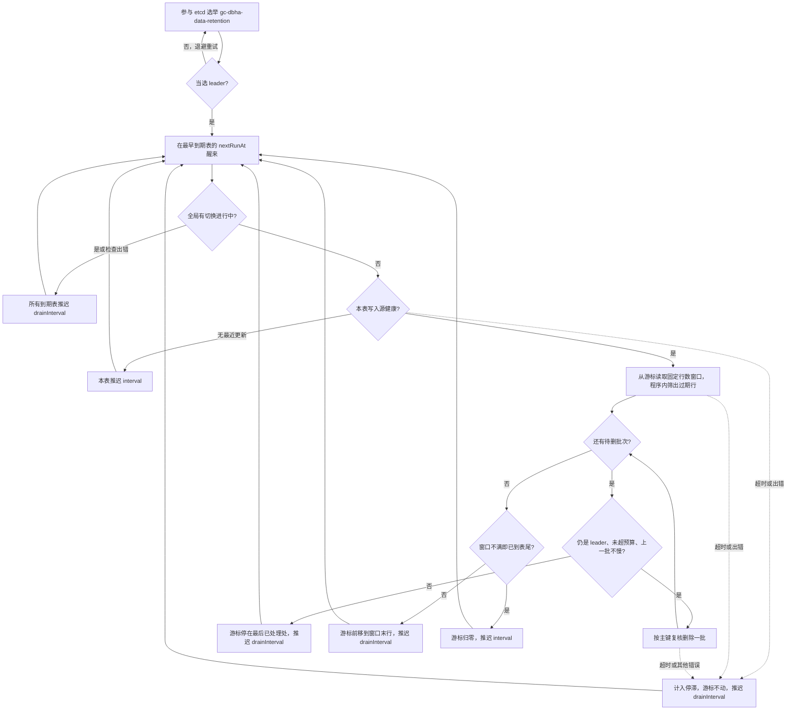

# 设计：analysis 过期数据清理

本文说明 analysis 如何物理删除 `t_dbm_metadata` 与 `t_dbha_status` 中长期不再更新的行，以及这样设计的理由：
它在性能、安全性和业务正确性上分别靠什么保障，为什么没有采用其他做法。配置项、上线预检、停止与回滚等操作说明见
[过期数据清理（运维手册）](data-retention.md)；指标与告警见 [analysis 指标](../observability/analysis-metrics.md)。

实现入口为 [internal/analysis/workflow/retention.go](../../internal/analysis/workflow/retention.go)，
由 `Workflow.Run` 中的 `startRetention` 启动。

## 1. 目标

### 1.1 问题

两张表都只 upsert、从不删除：

- `t_dbm_metadata` 由 analysis 元数据同步写入，只拉取 `running`、`available` 状态的实例。实例下架或状态变化后，
  对应行不再刷新，但一直留在表里。
- `t_dbha_status` 由 receiver 写入探测结果，每个实例、每种采集类型一行。探针停止、机器替换或主从角色变化后，
  旧行同样永久残留。

表因此持续膨胀。读路径虽然按 `updated_at` 窗口忽略了这些行，不影响检测结果，但仍要为它们付出扫描代价：
`ReadDbStatusWithDbInstances` 按 `(bk_cloud_id, db_ip, db_port)` 查询，而主键首列是 `machine_id`，条件用不上
主键索引，表越大越慢；`GetBizIDs` 也会把只剩过期行的业务交给扫描流程空跑。

### 1.2 目标

`updated_at` 早于保留期（默认 14 天）的行被物理删除，两张表的规模与在用实例数相当。

### 1.3 约束

- **故障诊断优先**：清理任何时候都不能拖慢故障发现和切换，出现异常时清理让路并告警。
- **零侵入**：不改扫描、切换和写入路径的代码，不修改数据库会话变量和隔离级别。`idx_updated_at` 是健康检查用的二级索引，在维护窗口内由 migrate 执行。
- **默认开启、向后兼容**：升级后自动生效，旧配置文件不需要修改。

### 1.4 非目标

- 不清理切换日志 `t_db_switching_log` 与快照日志 `t_db_switching_snapshot_log`。
- 不回收表空间（`DELETE` 后磁盘空间由 InnoDB 复用，需要时另行 `OPTIMIZE TABLE`）。
- receiver 配置多个写入库时，只清理 analysis 连接的库。

## 2. 工作原理

### 2.1 总体流程



### 2.2 选主

每套部署只允许一个 analysis 实例执行清理，避免多实例同时扫描同一张表：

- 使用独立的 etcd 选举 `gc-dbha-data-retention`。选举键由 `registryRootKeyPrefix + "/election/" + 名称` 组成，
  带部署前缀，多套部署共用一个 etcd 时互不影响。
- 判断是否仍是 leader 时，非阻塞读取 etcd session 的 `Done()` 通道；租约失效即视为失去 leader，立即停止并丢弃
  游标与调度状态，下次当选从表头重新开始。
- 创建选举或 `Campaign` 失败时按 1s 起、30s 封顶的指数退避重试，只在首次失败和首次达到上限时各打一条日志。
  不沿用元数据同步固定 100ms 的重试，因为每次创建选举都会新建一个 etcd 客户端和 session，etcd 不可用时高频重试
  会放大连接压力和日志量。

### 2.3 调度

- 两张表各自维护游标和下次执行时间 `nextRunAt`，互不牵制；循环在两者中较早的时间醒来，只处理已经到期的表。
- 当选后 1–10 分钟内随机执行首轮，便于上线后尽快在指标上观察到效果。
- 一次"遍历"从表头扫到表尾，由多个窗口组成。本遍未到表尾，或本次执行被打断，下一次在 `drainInterval`（默认 5m）
  后继续；扫到表尾且正常结束，下一遍在 `interval`（默认 6h）后开始。

### 2.4 窗口扫描与游标

每次执行只读一个窗口：从游标处按主键顺序读 `scanWindowRows`（默认 2 万）行，只取主键列和 `updated_at`，
过期判断在程序里完成。

- **游标是主键前缀**：`t_dbha_status` 为 `machine_id`，`t_dbm_metadata` 为 `(bk_cloud_id, ip)`。条件写作前缀
  `>=` 游标值，`ORDER BY` 只写前缀列。
- **何时前移**：本窗口的候选行全部处理完才前移到窗口末行的前缀；被截断或被打断时停在最后一个已处理候选的前缀，
  一个都没处理则不动。因死锁或锁等待超时跳过的批次算作已处理，下一遍再重试，避免卡在同一批上。
- **防卡死**：窗口已满、但新游标与起始游标相同（整个窗口都在同一前缀内）时，下一次对该前缀改用 `>`。
- **单轮上限**：每次最多处理 `maxRowsPerRound`（默认 1 万）个候选行。

### 2.5 分批删除

候选行按 `batchSize`（默认 500）分批，每批执行一条自动提交的语句：

```sql
DELETE FROM t WHERE (<主键列>) IN ((...), (...)) AND updated_at < ?
```

`updated_at < ?` 是复核条件，扫描之后被 upsert 刷新的行不会被删。批与批之间暂停 `batchSleep`（默认 200ms），
每 10 批重新做一次全局切换检查。

### 2.6 配置设计

配置位于 `analysis.yaml` 的 `workflow.retention`，各项含义与默认值见[运维手册第 3 节](data-retention.md#3-配置)。
设计上的考虑：

- **代码默认值、不新增部署占位符**：部署模板用 `{{...}}` 占位符渲染，新增占位符需要同步修改 rc 文件和部署脚本，
  升级时容易漏配。默认值写在代码里，配置文件缺失的键保留默认值，旧配置升级后直接生效。
- **校验放在 `Workflow.Run` 启动清理之前**：服务进程在 `run.go` 中自行 `viper.Unmarshal`，不经过 `config.Load`，
  放进 `config.Load` 的校验在服务进程里不会执行。非法值打印告警并回落到安全值，不阻止 analysis 启动。
- **校验规则的意图**：保留期不小于 24h 且不小于对应读窗口，保证不会删掉检测还可能读到的行；健康窗口不小于写入
  周期的 3 倍，避免同步或上报间隔被调大后健康检查永远失败。
- **不支持热加载**：analysis 收到 `SIGHUP` 只打印日志，不重新加载配置。在信号处理中改写 `config.Cfg` 会与扫描
  goroutine 并发读写同一结构，因此开关清理需要重启 analysis。

### 2.7 实现位置

| 内容 | 文件 |
| --- | --- |
| 配置结构、默认值与校验 | [internal/analysis/config/retention.go](../../internal/analysis/config/retention.go) |
| 切换检查、健康检查、窗口扫描、按主键删除、错误分类 | [internal/analysis/storage/retention.go](../../internal/analysis/storage/retention.go) |
| 选主、调度、游标、让路、停滞判定 | [internal/analysis/workflow/retention.go](../../internal/analysis/workflow/retention.go) |
| 指标上报接口与 APM 实现 | [internal/analysis/workflow/retention_metrics.go](../../internal/analysis/workflow/retention_metrics.go) |
| 指标定义与注册 | [internal/analysis/apm/metric.go](../../internal/analysis/apm/metric.go)、[provider_metrics.go](../../internal/analysis/apm/provider_metrics.go) |
| 启动 | [internal/analysis/workflow/workflow.go](../../internal/analysis/workflow/workflow.go) `Workflow.Run` |

测试与源文件同目录：

- `config/retention_test.go`：默认值、旧配置兼容、各条校验规则。
- `storage/retention_test.go`：对真实 MySQL 的集成测试，通过 `DB_TEST_*` 环境变量连接，连不上时自动跳过；
  对生产代码使用的同一份 SQL 断言 `EXPLAIN` 为 `range` + `PRIMARY` 且无 filesort。夹具行用固定前缀标识，
  测试只删除自己插入的行，不运行完整清理循环。
- `workflow/retention_test.go`：用假存储、假时钟、假选举覆盖调度、游标、让路、错误分类、停滞判定和选举退避。

## 3. 性能、安全性、业务正确性的保障机制

### 3.1 性能

**窗口扫描和删除的成本固定。** 窗口按行数限定，不在 SQL 里按 `updated_at` 过滤，因此窗口扫描和按主键删除
不会出现扫描行数取决于数据分布、最坏接近全表扫描的语句。二者的执行计划都是 `range` + `PRIMARY`，窗口扫描没有
filesort，由集成测试的 `EXPLAIN` 断言保证。删除语句写成 `DELETE t FROM t AS t FORCE INDEX (PRIMARY)`，避免优化器
在过期行占多数时改走 `updated_at` 索引。状态表一批默认 500 行、5 个主键列，再加截止时间，一条语句 2501 个占位符。
`batchSize` 超过 13106 时，批大小、单轮行数和扫描窗口一起退回默认，避免 `5*batchSize+1` 超过 65535。
`slowDeleteThreshold` 仍是 1 秒，这次没有新的耗时测量。参考数据（本地 MySQL 9.1、
`t_dbha_status` 20 万行的测试环境，不作为生产承诺）：读取一个 2 万行窗口约 0.02 秒。

**`ORDER BY` 只写游标前缀列。** `t_dbha_status` 的主键经过多次 `CONVERGE PRIMARY KEY` 收敛，存量库中后续列的
顺序不一定与模型一致；写全主键排序时一旦与实际列序不符，就会对整个范围做 filesort。只按前缀排序时，按主键扫描
天然满足顺序。

**`updated_at` 有二级索引，只给健康检查用。** 两张表都有 `idx_updated_at`。健康检查是
`WHERE updated_at > ? LIMIT 1`。常态下几乎所有行都落在窗口内，优化器可以走全表扫描；索引用于积压、新行很少的时候。
每轮采集或同步都会改 `updated_at`，这份索引打在写入热路径上，这是为积压场景接受的开销。健康检查不写
`FORCE INDEX`：迁移还没执行时语句退回全表扫描，而不是因为索引不存在而失败。超时仍会被记成停滞。

**限速。** 每次最多处理 `maxRowsPerRound` 行，分批删除并在批间暂停；积压期每 5 分钟一个窗口，平时每 6 小时一遍，
负载平滑分布，binlog 增长和从库复制延迟可控。

**不阻塞诊断读取。** analysis 的扫描读取都是普通 SELECT（快照读），不会被删除语句持有的行锁阻塞；analysis 的
连接池默认不限制连接数，清理占用的连接不会挤占扫描 worker。表变小后，`ReadDbStatusWithDbInstances` 等用不上
主键索引的查询还会变快。

否决的做法：

- **按复合主键行构造器 `(a, b, ...) > (?, ?, ...)` 分页**：MySQL 对行构造器的不等比较不能稳定走主键范围扫描，
  每批都可能退化为全表扫描。
- **在 SQL 中按 `updated_at < cutoff` 过滤候选**：陈旧行稀少时一条语句接近全表扫描，只能靠超时截断；超时后
  MySQL 不返回扫到的位置，游标无法前移，会在同一区段反复超时。

### 3.2 安全性

#### 运行安全：不影响诊断、不失控、可停可退

**让路机制。** 以下情况清理立即结束本次执行，`drainInterval` 后重试：

- 全局有切换进行中：`t_db_switching_snapshot_log` 中存在 `switchTimeout` 内开始、状态为 `doing` 的记录。
  用开始时间限定，是为了排除进程崩溃遗留的 `doing` 记录，否则清理会被永久挡住。
- 删除变慢：上一批删除耗时超过 `slowDeleteThreshold`。这是清理自己测到的数据库延迟，不依赖本实例负责多少业务；
  执行计划退化时第一批就会触发。
- 超出时间预算：单表单次执行超过 `roundTimeBudget`。

写入源健康检查发现表中近期没有任何更新时（同步或上报中断），本次跳过该表、`interval` 后再检查。

**锁与超时。** 按主键删除已存在的行，在默认隔离级别下只加记录锁，且单条语句是毫秒级的自动提交事务；扫描后
刚恢复上报的行才可能与 receiver 冲突，最多短暂等待。查询语句同时受 `MAX_EXECUTION_TIME` 提示和客户端 ctx
超时约束，删除语句受 ctx 超时约束。

**SQL 结果分类。** 所有语句的结果统一归类，原则是：正常让路（有切换、写入源无更新）不计入停滞；锁冲突跳过该批；
超时和其他错误（如快照表不存在、没有 DELETE 权限）一律结束本次执行并计入停滞，任何让清理长期不运行的故障都会
告警，不会静默失效。切换检查本身出错时按"有切换"处理以偏安全，但仍计入停滞。分类表见
[运维手册第 5 节](data-retention.md#5-观测)。

**选举安全。** 退避重试避免 etcd 故障时频繁建连；退出时关闭选举撤销租约，其他实例可立即接任。网络分区时旧 leader
要等租约到期才感知失去 leader，可能与新 leader 短暂同时执行；删除带复核条件、结果幂等，最坏只是重复扫描。

**panic 隔离。** 每张表的单次执行用 `safe.Run` 包裹；执行前先把 `nextRunAt` 推后 `drainInterval`，即使执行中
发生 panic，也不会因为表一直处于到期状态而空转。

**可观测。** 停滞判定把每次执行的结果分为三类：删除了行或没有待删行算"进展"，重置计时；有切换或写入源无更新算
"中性"，不影响计时；有待删行却没删掉、超时或出错算"证据"。连续 `stallAlertAfter` 没有进展且存在证据时，
`retention_stalled` 置为 1。当选时先把"最近完成遍历时间"写成当选时间，否则从未完成过遍历时该指标不存在，
"长期未完成遍历"告警永远不会触发。`retention_attempted_rows_total` 只在批次提交时计数，被打断后重读的候选不会
重复计入。失去 leader 时清空本实例的状态类指标，避免旧 leader 留下过期序列。指标清单与告警规则见
[analysis 指标](../observability/analysis-metrics.md)。

**可停可退。** 配置 `enabled: false` 并重启 analysis 即停止清理；方案不涉及表结构和数据格式，回退版本即可回滚，
已删除的行会随同步与上报自动重建，无需数据修复。

#### 数据安全：不删错、不越权、不泄露

- **SQL 全部参数化。** 表名与列名来自 `hamodel` 常量；健康检查的表名只接受两张表的常量，其他值直接返回参数错误，
  不拼接任何外部输入。
- **删除范围受双重限制。** 主键列表只来自本轮扫描结果，且 DELETE 条件同时要求 `updated_at < cutoff`，即使主键
  列表有误也不会删除未过期的行。
- **最小权限。** analysis 存储账号只需要两张表的 DELETE 权限，上线预检时核对。
- **日志不泄露。** 日志只输出表名、计数、耗时和 `errmsg`，不输出主键值（含 IP）和连接信息。

否决的做法：

- **比例保护（待删行超过表行数一半就放弃）**：历史积压占多数时会永远挡住首次清理，而且需要额外一次全表 COUNT。
  改为直接检查写入源是否在工作。
- **按候选数决定是否加速**：候选行反复删不掉时（锁冲突、复核不通过）会每 5 分钟扫描一次且永不回落。改为按实际
  删除数和是否被打断决定节奏。
- **修改隔离级别为 READ COMMITTED、设置会话级锁等待超时**：依赖 binlog 格式，会话变量还可能随连接回到连接池影响
  其他查询；按主键删除的锁范围本来就很小，收益不足以抵消风险。

### 3.3 业务正确性

**判定依据可靠。** `updated_at` 由 GORM `autoUpdateTime` 在每次插入和 upsert 时写入当前时间，不存在零值或 NULL
的歧义。GORM 未设置 `NowFunc`，写入方使用进程本地时间，DSN 为 `loc=Local`，与清理计算 cutoff 的时间基准、
以及现有 60 秒 status 读窗口的时间基准一致。

**被删的行不参与检测。** 默认 14 天远大于所有现有读窗口：analysis 元数据 24h（`readDbMetaOffsetDuration`）、
status 60s（`readDbMetricOffsetDuration`）、admin `probeMetadata.tombstoneAge` 默认 24h。切换建单直接查询 DBM，
不读本地表。因此删除这些行不改变检测和切换结果。

**复核删除。** DELETE 按最新已提交版本判断 `updated_at < cutoff`，扫描后被刷新的行不会被删。删除后实例恢复上报，
或重新出现在 DBM 同步结果中，upsert 会重新插入该行。

**游标不漏删。** 游标值只回传给 MySQL 比较，不在程序里比较大小。两张表默认使用不区分大小写的 `utf8mb4` 排序规则，
由列的排序规则决定顺序和相等，保证与主键顺序一致；防卡死判断用"游标是否变化"，不在程序里比较首末行前缀，
避免大小写不同但排序规则视为相等的值被误判。候选行全部处理完游标才前移，被打断时停在最后已处理处，不会跳过
未处理的过期行。

**唯一可见的行为变化。** `GetBizIDs` 不再返回只剩过期行的业务，这些业务原本在扫描中也拿不到元数据。
`AssignedBizIDs` 对每个业务单独做一致性哈希，去掉这些业务不会改变其他业务在 analysis 实例间的归属。

否决的做法：

- **用 `deleted_at` 软删再物理删**：模型中的 `deleted_at` 是非指针时间类型，upsert 每次都把它写成零值时间，
  存量行大多不是 NULL，按 `deleted_at IS NULL` 过滤会误伤全部活跃行；软删期间的行对业务不可见、又会被同步与上报
  自动重建，审计价值很低；每行还要多写一次 binlog，并改动所有读路径。
- **元数据同步侧做差异比对删除**：按分片同步时，某个分片请求失败或返回不完整就会误删；且只能覆盖
  `t_dbm_metadata`，无法处理 `t_dbha_status`。
- **库外 MySQL Event 或 cron 脚本**：没有选主，多环境配置不一致，也无法接入现有指标与告警。

### 3.4 保障的边界（已知限制）

以下情况不在上述机制的覆盖范围内：

- receiver 配置多个写入库时，只清理 analysis 连接的库。
- 过期行最晚在"保留期 + 一遍遍历耗时"后删除（`t_dbha_status` 100 万行时一遍约 4 小时）。
- 执行计划退化时清理会被"删除变慢"持续挡住，表现为停滞告警，需要人工处理；它不会拖慢诊断。
- 全局切换检查依赖快照日志写入成功（写入超时取 `switchLogWriteTimeout`，默认 1 秒），属于补充保护；主保护是删除延迟和时间预算。
- 写入方主机时钟落后超过保留期时，其新写入的行会被当作过期行删除；这种时钟偏差早已让 60 秒的 status 读窗口失效，
  属于既有的部署前提。
- migrate 的 `ALTER` 把 `lock_wait_timeout` 和 `innodb_lock_wait_timeout` 临时设为 5 秒，拿不到元数据锁就失败。拿到锁之后的重建时间不受这 5 秒限制，执行前先停写并关闭清理。
- `DELETE` 不回收表空间。

---

返回：[文档入口](../README.md)
