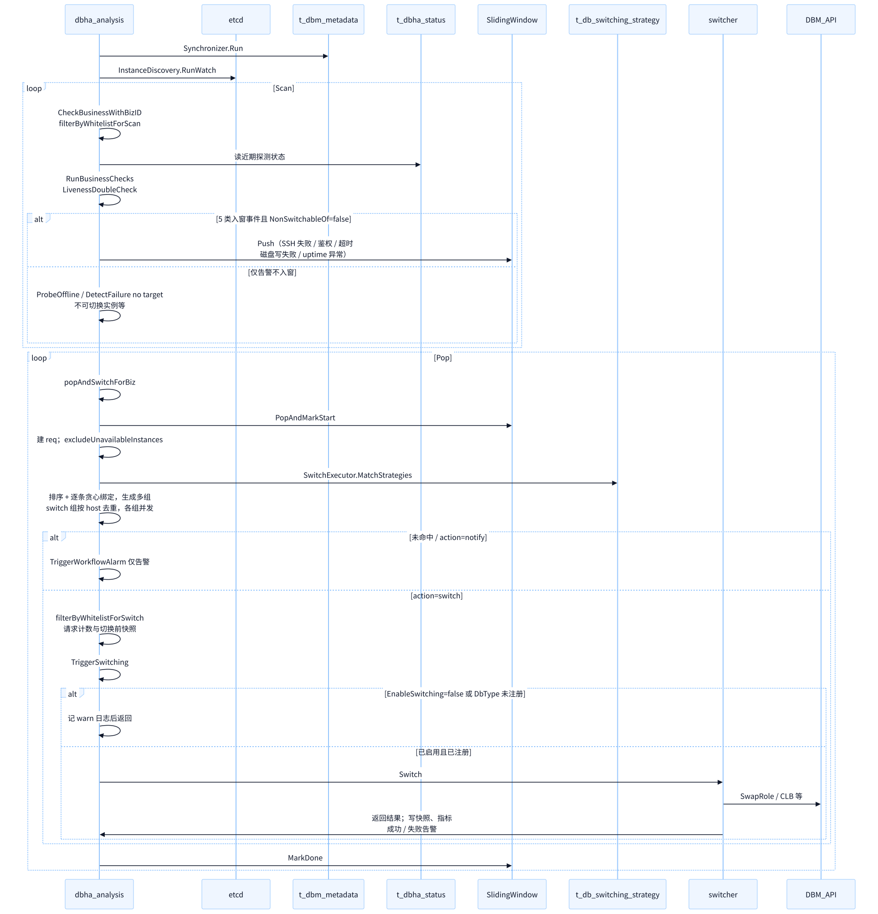

# 流程：故障判定与切换

Analysis 的 `Workflow` 在服务启动后并行运行：DBM 元数据同步、etcd 分片 watch、定时 Scan（发现疑似 → 二次探测 → 条件满足则入滑动窗口）、定时 Pop（成熟后匹配策略并切换）。

入窗语义以 [mysql-detection-design.md §5](../detection/mysql-detection-design.md) 为准；本文描述 Scan/Pop、窗口、锁、策略与白名单运行时路径。

相关文档：[架构总览](../architecture/overview.md) · [采集与上报](probe-harvest-and-report.md) · [MySQL 探测设计 §5](../detection/mysql-detection-design.md) · [文档索引](../README.md)

## 1. 参与方

| 角色 | 说明 |
|------|------|
| **Synchronizer** | 从 DBM 拉取元数据写入 `t_dbm_metadata` |
| **InstanceDiscovery** | 基于 etcd 的 analysis 实例列表与业务分片 |
| **Scan 循环** | `ScanBusinesses` → 按业务检查探测数据 → 二次探测 →（仅部分结果）推入滑动窗口 |
| **Pop 循环** | `PopAndSwitch` → 弹出成熟故障组 → 策略匹配 → notify / `SwitchExecutor` / switcher → DBM |
| **MySQL** | `t_dbha_status`、策略表、切换日志 / 快照等 |

## 2. 工作原理与交互

编排入口 [`Workflow.Run`](../../internal/analysis/workflow/workflow.go)：启动后并行跑元数据同步、etcd 分片 watch、Scan、Pop。Scan 与 Pop 分别使用 ScanLock / SwitchLock，避免多 AM 实例踩踏，并允许扫描与切换流水线化。

> 本图为时序图，不使用语义配色。

图下要点：

- Scan 持 `ScanLock`；二次探测为 SSH + `dbha-probe health -j`（不含 keepalive HTTP）。**入窗事件共 5 类**（SSH dial/session 失败、SSH 鉴权失败、SSH 超时、磁盘写失败、uptime 异常，见 §2.1），且需通过 `failure.NonSwitchableOf` 过滤；策略匹配与切换由 Pop 异步处理。
- Pop 持 `SwitchLock`；`PopAndMarkStart` 按 `FirstAt + windowDuration` 成熟弹出并打 inflight；普通策略按 EventName，special 按角色组合（不校验 EventName）。
- `MarkDone` 在 `handleFailureGroup` 末尾 `defer` 执行，与是否切换无关；当前 MySQL 与 Redis switcher 均已注册。

代码入口：[`Workflow.Run`](../../internal/analysis/workflow/workflow.go) · [`checker`](../../internal/analysis/workflow/checker.go) / [`detector_handler`](../../internal/analysis/workflow/detector_handler.go) · [`switch_flow`](../../internal/analysis/workflow/switch_flow.go)

### 2.1 入窗条件与事件改写

二次探测入口 [`DetectorHandler.ProcessResponse`](../../internal/analysis/workflow/detector_handler.go)。Detector 任务默认事件名为 `ProbeOffline`（`missed probe`）。

| 二次探测结果 | 事件名（告警 / 入窗） | 是否入窗 |
| --- | --- | --- |
| SSH dial/session 失败 | `DoubleCheckSshFailureV1`（`dbha_doublecheck_ssh_fail`）+ `connection exception` | **是** |
| SSH 鉴权失败 | `SshAuthFailure`（`dbha_ssh_auth_failure`）+ `ssh auth failure` | **是** |
| SSH 建连 / 执行超时 | `SshTimeout`（`dbha_ssh_timeout`）+ `ssh timeout` | **是** |
| health 退出码 40（磁盘写校验失败） | `DiskWriteFailure`（`dbha_disk_write_failure`）+ `disk write failure` | **是** |
| health 退出码 41，或 uptime 低于 `detector.ssh.maxUptime` | `UptimeFailure`（`dbha_uptime_failure`）+ `uptime failure` | **是** |
| 有效 Pid（解读为无目标 DB 指标） | 改写为 `DetectFailure` + `no target` | 否（仅告警） |
| InvalidPid / 其它失败（ExitCode≠0、JSON 解析失败等） | 多为默认 `ProbeOffline` | 否（仅告警） |

上表「是」的事件名同时作为窗内 EventName。入窗前还会经 `failure.NonSwitchableOf` 过滤：命中 DbType 注册的不可切换规则（当前 Redis 注册：集群类型为 PredixyRedisCluster / PredixyTendisplusCluster 且机器类型非 predixy 的实例）只告警、不入窗。

probe 侧 `DetectFailure`（建连失败）只写入 `HarvestData.Events`，经 `CheckEventWithBizId` 触发二次探测候选；**事件名不带入窗口**。细则见 [mysql-detection-design.md §5](../detection/mysql-detection-design.md)。

`RunBusinessChecks` 四路中 `CheckDbHosts`（`ParseHostStatus`）对所有 DB 类型为 stub；`CheckDbStatus` 仅 MySQL parser 为 stub（Redis parser 会产出 `DetectFailure` 并交给 `CheckEventWithBizId`）。MySQL 故障主链路依赖 probe 上报 Events + missed probe + SSH 二次探测。

## 3. 滑动窗口

`BizWindowManager` 按 BizID 隔离窗口，把「二次探测确认故障后入窗」与「成熟后触发切换」解耦。

> 色例：蓝=Push/成熟主路径；灰虚线=丢弃 / inflight 超时清理。

要点（与 [`sliding_window.go`](../../internal/analysis/workflow/sliding_window.go) 一致）：

- 合并键：`instanceWindowEventKey`（实例 `bkCloudID:ip:port:dbType` + `EventName`）；同实例同事件合并计数，`FirstAt` 仅首次 Push 写入。实例键 `instanceWindowKey`（`bkCloudID:ip:port:dbType`）只用于 inflight 判定与 `MarkDone`。
- 成熟条件：`FirstAt + windowDuration < now`（代码用 `FirstAt.Before(now - windowDuration)`）；默认 `windowDuration=0` 时几乎立即成熟。
- `PopAndMarkStart` 原子弹出并打 inflight，按 `FirstAt` 升序返回，避免 Pop 与 Push 竞态。
- inflight 期间丢弃同实例 Push；`MarkDone` 在 `handleFailureGroup` 结束时统一解除（`defer markDoneAll`）；超时 `inflightTTL`（默认 30s）自动清理。

## 4. 策略匹配与切换边界

Pop 成熟故障组后进入策略匹配与切换边界（对齐 [`SwitchExecutor.MatchStrategies`](../../internal/analysis/workflow/switch_flow.go) / [`strategy.go`](../../internal/analysis/workflow/strategy.go) / [`workflow.go`](../../internal/analysis/workflow/workflow.go) 的 `handleFailureGroup`）。

> 色例：蓝=主路径；绿=命中（matched 非空）与 action=switch 两条判定分支；灰=未命中 / 仅告警 / 跳过。

匹配流程：

1. `handleFailureGroup` 先查 DBM 元数据并剔除不可用实例（`excludeUnavailableInstances`），无元数据或无可用实例时直接返回。
2. `MatchStrategies` 读取业务 + 全局策略后 `SortCandidates` 排序：业务级优先于全局 → `Priority` 小者优先 → 同优先级 switch 优先于 notify。
3. 按序逐条策略对「尚未绑定的实例 + 事件」贪心匹配：special 策略用注册的 `SpecialMatchFunc`（按角色组合，不校验 EventName），普通策略用 `FilterInstancesByEventAndCount`（EventName 相等且 Count ≥ `TriggerCount`，`TriggerCount≤0` 视为 1）。每条命中的策略生成一个组，已绑定的实例事件不再参与后续策略。
4. 所有策略都未绑定的实例归入 `Strategy=nil` 的组，按 notify 处理（`TriggerWorkflowAlarm` 告警 + notify 快照）。
5. `buildGroupTasks`：非 switch 组转为 notify 任务；switch 组按主机（`bkCloudID:ip`）去重，已被前序 switch 组占用的主机跳过。各任务并发执行。
6. switch 任务（`handleStrategySwitch`）内才做 Pop 阶段白名单过滤（`filterByWhitelistForSwitch`，`EnableWhiteListForSwitch=false` 或 `EnableSwitching=false` 时跳过）。过滤后只有白名单集群的实例继续切换，其余实例只告警并写 notify 快照；白名单查询失败则告警并放弃本组切换。Scan 阶段另有 `filterByWhitelistForScan`（受 `EnableWhiteListForScan` 控制，默认开启；开启时 `dbhav1ApiBlackWhitelistGet.api` 为空，analysis 启动即失败，避免带空接口运行导致所有业务被跳过扫描）。总开关 `EnableSwitching=false` 或 DbType 未注册 switcher 时，`TriggerSwitching` 仅记 warn 日志返回。

配置要点：

- **默认全局策略种子**：策略表为空时，`dbha-admin migrate --type data` 插入 5 条默认行
  （`DoubleCheckSshFailureV1`、`SshAuthFailure`、`SshTimeout`、`DiskWriteFailure`、`UptimeFailure`；均为 `action=switch`，`scope=host`，`TriggerCount=1`，`Priority=9999`，`BkBizID=0`）。
  已有任意策略行时，缺失行需要 `--repair-missing-data`；软删除行不会恢复。
  `--type data` 不修改主键或列定义。`schema` / `all` 收敛策略表主键时可能锁表，执行前需要停止写入。
  完整维护规则见 [migrator 设计](../architecture/migrator-design.md)。
- **special 常量**（非 harvester emit、**非**入窗 EventName）：`TendbhaProxyBackendFailure`、`TendbclusterSpiderRemoteFailure`；常量定义在 [`db_event.go`](../../pkg/storage/haprobe/db_event.go)，匹配函数在 [`provider/mysql/switch/register.go`](../../internal/provider/mysql/switch/register.go) 注册。
- 策略表：`t_db_switching_strategy`；`TriggerEventName` / `action`（`switch`|`notify`）可配；总开关 `EnableSwitching`。

## 5. 关键代码路径

| 步骤 | 路径 |
|------|------|
| 编排 | [`internal/analysis/workflow/workflow.go`](../../internal/analysis/workflow/workflow.go) |
| 元数据同步 | [`workflow/synchronizer.go`](../../internal/analysis/workflow/synchronizer.go) |
| 分片发现 | [`workflow/instance_discovery.go`](../../internal/analysis/workflow/instance_discovery.go) |
| 检查与二次探测 | [`workflow/checker.go`](../../internal/analysis/workflow/checker.go)、[`detector_handler.go`](../../internal/analysis/workflow/detector_handler.go)、[`internal/analysis/detector`](../../internal/analysis/detector) |
| 滑动窗口 | [`workflow/sliding_window.go`](../../internal/analysis/workflow/sliding_window.go) |
| 白名单 | [`workflow/dbhav1_whitelist.go`](../../internal/analysis/workflow/dbhav1_whitelist.go) |
| 策略与切换 | [`workflow/switch_flow.go`](../../internal/analysis/workflow/switch_flow.go)、[`strategy.go`](../../internal/analysis/workflow/strategy.go)、[`internal/analysis/switcher`](../../internal/analysis/switcher) |
| DBM 客户端 | [`internal/analysis/dbm`](../../internal/analysis/dbm) |
| 快照 / 日志 | [`workflow/switch_snapshot_log.go`](../../internal/analysis/workflow/switch_snapshot_log.go)、[`snapshotlogger`](../../internal/analysis/switcher/snapshotlogger) |

## 6. 设计要点

- **滑动窗口**：把「瞬时探测失败」与「触发切换」解耦；同实例同事件合并计数 + inflight 防重复切换。
- **分片 + 业务锁**：多 analysis 实例水平扩展时，同一业务同一时刻只有一个实例在切换。
- **策略驱动**：是否切换、匹配何种 `TriggerEventName` 由策略表配置；探测侧入窗事件名（如 SSH 失败）在 detector 路径硬编码。
